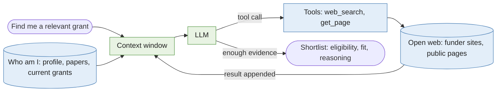

## Current loop

Here's what grant discovery at UVM look like right now, as a loop

A couple of notes about that loop:
- First it is a loop insofar as we are talking about discovery before moving forward the grant into the hands of the Sponsored Administration Office (SPA).
- There is much manual labors hidden in the tools; e.g. you need to complete your Pivot-RP profile with your interests and relevant categories so that you get a filtered list of potentially relevant opportunities. 
- Being part of that loop, knowledge is accomulating as part of the R&D knowledge but might be incomplete depending on the team structure. 

## The agent loop

Now, what would a fully automated agent loop might look like?

A couple of notes about that loop:
- No R&D; retrieval is only the agents in the loop.
- No `Pivot-RP` as Clarivate would probably sell that for big bucks. 

## How can agents and research staff work together?

==TODO==

## Relevant agent tools

- `search_opportunities(query, filters)`
- `check_eligibility(faculty_id, opportunity_id)`
- `list_opportunities(filters)`
- `get_opportunity(id)`
- `get_profile(faculty_id)`
- `search_publications(faculty_id, query)`
- `get_past_awards(opportunity or sponsor)`

We could maybe add
- `log_decision(faculty_id, opportunity_id, decision, reason)` to accumulate edges in the R&D knowledge graph
- `score_fit(faculty, opportunity)` using something like tabFPN once we have labels

## Next steps

- [[How to work with agents for pre-award management]]