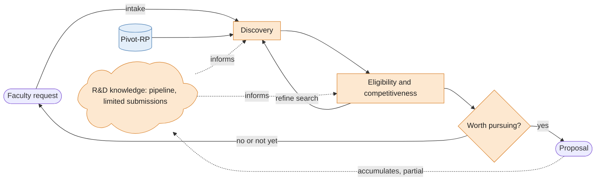

Grant discovery is one of the core features of the "Horizon" project. Depending on how savvy is someone with agentic workflow, the human loop can be fully automated in that an agent can know everything there is to know about you and current funding opportunities and assess fit between yourself and specific grants. By in doing so, the agent would forego domain expertise from research staff. 

## Current loop

Here's what grant discovery at UVM look like right now, as a loop

A couple of notes about that loop:
- First it is a loop insofar as we are talking about discovery before moving forward the grant into the hands of the Sponsored Administration Office (SPA).
- There is much manual labors hidden in the tools; e.g. you need to complete your Pivot-RP profile with your interests and relevant categories so that you get a filtered list of potentially relevant opportunities. 
- Being part of that loop, knowledge is accomulating as part of the R&D knowledge but might be incomplete depending on the team structure. 

## The agent loop

Now, what would a fully automated agent loop might look like?

A couple of notes about that loop:
- No R&D; retrieval is only the agents in the loop.
- No `Pivot-RP` as Clarivate would probably sell that for big bucks. 

## How can agents and research staff work together?

==TODO==

## Relevant agent tools

- `search_opportunities(query, filters)`
- `check_eligibility(faculty_id, opportunity_id)`
- `list_opportunities(filters)`
- `get_opportunity(id)`
- `get_profile(faculty_id)`
- `search_publications(faculty_id, query)`
- `get_past_awards(opportunity or sponsor)`

We could maybe add
- `log_decision(faculty_id, opportunity_id, decision, reason)` to accumulate edges in the R&D knowledge graph
- `score_fit(faculty, opportunity)` using something like tabFPN once we have labels

> [!agent] Claude: filters for `search_opportunities` and `list_opportunities`
> Proposed, not decided. Filters are for hard constraints checkable against structured fields; research topic goes in the `query`, since subject taxonomies differ between sponsors and would drop good matches.
>
> | Filter | Example | Notes |
> |---|---|---|
> | `deadline_after` / `deadline_before` | next 60 days | plus a `rolling` flag for no deadline |
> | `status` | open | drop closed and archived by default |
> | `sponsor` / `sponsor_type` | federal, foundation, industry, state | |
> | `award_min` / `award_max`, `duration` | | fits scope |
> | `opportunity_type` | research, fellowship, training, equipment, travel | separates a grant from a prize or travel award |
> | `career_stage` | early-career, any | common eligibility cut |
> | `institution_type` | R1, PUI, any | |
> | `epscor_idea_eligible` | true | Vermont is an NSF EPSCoR / NIH IDeA state, so some programs are open to UVM for that reason (not re-checked) |
> | `citizenship` / `residency` | | |
> | `limited_submission` | false | only fillable if R&D writes the list down |
> | `cost_share_required`, `indirect_cap` | | foundations often cap indirect costs |
> | `team` | solo PI, multi-PI, partner required | |
> | `posted_since` | last run date | makes recurring runs cheap |
>
> Two design points:
> - **Unknown should not exclude.** If the pipeline could not parse a field, return the opportunity flagged `unknown` instead of dropping it, otherwise a strict filter hides grants silently.
> - **Report what each filter removed.** Return a count excluded per filter, so an agent that gets zero results can tell which filter over-constrained.
>
> `eligible_for=faculty_id` could apply the profile-derived filters automatically, but it overlaps with `check_eligibility`. Probably keep that logic in one place and leave these filters about the opportunity itself. How many of these can be filled depends on the pipeline: with Pivot-RP out of reach, deadline, sponsor and award size are likely reliable from the open web, eligibility fields much less so.

## Next steps

- [[How to work with agents for pre-award management]]