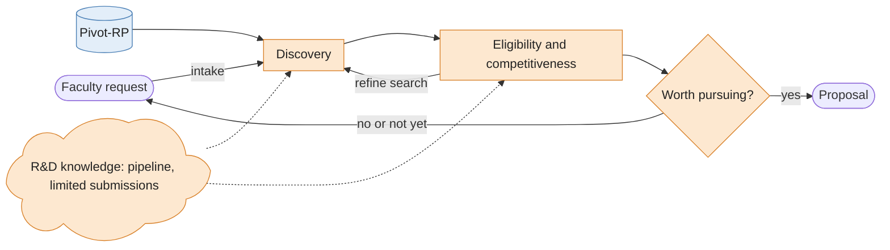

---
topic:
harness:
date: 2026-10-13
addedBy: Jonathan St-Onge
tags:
---
## Current loop

Here's what grant discovery at UVM look like right now, as a loop

A couple of notes about that loop:
- First it is a loop insofar as we are talking about discovery before moving forward the grant into the hands of the Sponsored Administration Office (SPA).

## Agent loop

Now, what would a fully automated agent loop might look like?

