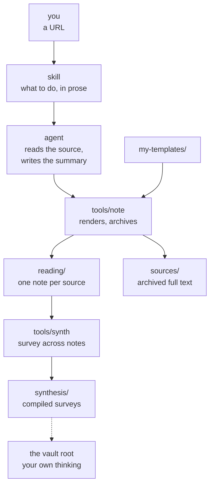

# tales-from-the-agent-loop


> I first learned about [Tales from the Loop](https://www.simonstalenhag.se/tftl.html) from this [soundtrack](https://www.youtube.com/watch?v=2PkbfZWqqSw&list=PLEFjGrqW-nqkACZYF5oStYVjqhhsOWtnL) by Philip Glass and Paul Leonard-Morgan. I loved the imagery. It’s about stories from a sci-fi suburbia built on top of The Loop, a deep underground particle accelerator that creates wrinkles in the inhabitants’ lives.

The Loop in Stålenhag’s work is a place, with some frontier technology that people at the surface barely understand. The Loop also causes wrinkles in our reality, but it is disembodied. As it is now, most tech bros talk of the Loop belonging to the agent. The Agent Loop is how LLMs stretch their hands into the digital realm, taking actions on our filesystem and beyond (the web). In doing so, they can create wrinkles in our reality: spiking website traffic, making open-source developers’ lives miserable, and putting white-collar workers out of their jobs.

In this project, we learn about that emerging Agent Loop from a humanistic perspective. How can we share the Loop with the Agent in ways that are empowering to us as humans? Maybe a day will come when we’ll need to ask whether we should make the LLM happy in that loop too... but we’re not there yet.

## How to get started

Clone it and open the folder as a vault in [Obsidian](https://obsidian.md).

```sh
git clone https://github.com/jstonge/tales-from-the-agent-loop.git
```

One setup step: **Settings → Appearance → CSS snippets → enable `agent-callout`**.
That's what tints agent-written blocks orange, so you can tell at a glance which
prose is a person's and which a machine's.

To add something you've read, hand your agent the link:

```
/vault-note https://tidydesign.substack.com/p/what-is-an-agent
```

It fetches the page, saves a readable copy into `sources/` so the note outlives
the link, fills in the frontmatter, and drafts a summary. The summary is marked
as the agent's. `## Why do I bring this up?` is left for you, under your own
name and dated, so two of us can write in one note without overwriting each
other.

Once there are enough notes to compare, `/vault-synthesis` builds a survey
across them — see [`current-harnesses`](synthesis/current-harnesses.md).

When you have something to say that isn't about any one source, start an
atomic note at the root instead — one idea per note, linked to the others and
to the reading it rests on:

```sh
tools/note --slug what-minimal-buys-you --template atomic-notes
```

It fills in the date and your name. The whole note is yours; nothing else
writes there. `tools/vault-index` shows which of your notes nothing links to,
which link nowhere, and which cite no reading.

Under the hood, the work splits in two: the skill is prose telling the agent
what to do, and the tool does only what doesn't need judgment. Nothing in
`tools/` calls a model — if it had to think, your notes would depend on it
thinking the same way twice.



`my-templates/` has two consumers, not one: Obsidian's Templates plugin points
at the same folder, so adding a field to `reading.md` changes both what the tool
emits and what you get pressing Cmd+T, with no code change.

Where things live:

| | |
| --- | --- |
| `reading/` | one note per thing read |
| `who/` | the people and organisations behind them |
| `synthesis/` | surveys compiled across the reading notes |
| `sources/` | archived full text, so nothing depends on a live URL |
| the root | our own thinking, one atomic note per idea |

If you work with something other than Claude Code, install the skills where your
agent looks and tell it whose name to sign with:

```sh
npx skills add jstonge/tales-from-the-agent-loop --skill vault-note --agent codex
npx skills add jstonge/tales-from-the-agent-loop --skill vault-synthesis --agent codex
export VAULT_AGENT=Codex
```

The conventions are in [AGENTS.md](AGENTS.md), and the CLI underneath the skills
is documented in [tools/README.md](tools/README.md).

